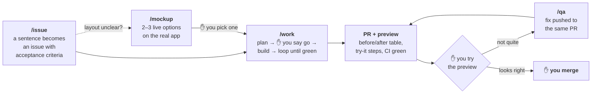

# Claude Code Starter

**How I ship software with Claude Code.** I write issues and merge pull requests; Claude does
everything in between. Five commands, one sign-off per issue, a loop that doesn't stop until the
work is green, and GitHub Actions as the only judge of "green".

This repo is that workflow, packaged: the commands, the skills behind them, the hooks, the GitHub
Actions and the scripts, around a tiny demo app so every piece runs on day one. Use it as a
template, or lift the parts you want into your own repo. — *Adam Janes*



`/overnight` runs that across every issue labelled `ready` while you sleep, and leaves one report.

---

## The idea in 30 seconds

- **You stop twice per issue:** once to say "go" on a short plan, once to try the preview and
  merge. Everything else is decided, done and written down without you.
- **Nothing leaves the loop until it's green.** Builders edit; the orchestrator checks the diff,
  CI runs the full suite, a fresh Claude attacks the change. Anything wrong goes to a fresh fixer
  agent and the loop goes round again.
- **The verdict comes from GitHub Actions, never a laptop.** Lint with custom rules, strict
  types, unit and convention tests, the build and a browser smoke test, on exactly the tree that
  will merge.
- **Every PR looks the same:** a before/after table per issue first, then try-it steps with exact
  URLs, then the plan, the run log, the gate and the review.
- **The orchestrator stays small.** Sub-agents do the reading and editing in their own context
  windows; the orchestrator only holds decisions and evidence.
- **Agents never merge.** Branch protection, a deny rule and a hook all say so independently.

## The five commands

| Command | You type | You get back | It stops for you |
|---|---|---|---|
| **`/issue`** | `/issue "overdue tasks should say how late they are"` | A GitHub issue with testable acceptance criteria | Once, to confirm the draft |
| **`/work`** | `/work 2` | A PR closing #2: CI green, review SHIP, before/after, preview, try-it steps | Once, to approve the plan |
| **`/qa`** | `/qa 4 "say 'Due today', not 'Today'"` | The fix on the same PR, a QA record on the thread, re-test steps | Never (your feedback is the sign-off) |
| **`/mockup`** | `/mockup 5` | A design page with 2–3 clickable options on a live preview | When you pick an option |
| **`/overnight`** | `/overnight` | 3–6 CI-green PRs in a tested merge order, one morning report | Once, to approve the shift |

## Quick start

```bash
# 1. "Use this template" on GitHub, then:
gh repo clone <you>/<your-repo> && cd <your-repo>
pnpm install && pnpm check

# 2. Labels and branch protection (shows the plan, asks before changing anything)
bash scripts/setup-github.sh

# 3. Go
claude
```

```
> /issue "the Done tab should list completed tasks newest first"
> /work 1
```

Previews, screenshot hosting and the rest: [docs/setup.md](docs/setup.md).

---

## The loop

This is the core of it. A `/work` run is a set of loops, one inside the other, and each has one
exit: green.

```
 ┌─ you ────────────────────────────────────────────────────────────────────────────────┐
 │  try the preview ──not quite──▶ /qa ──▶ same branch, same loops below ──▶ preview    │
 │  ┌─ orchestrator (Opus) ─────────────────────────────────────────────────────────┐   │
 │  │                                                                               │   │
 │  │  builders ──▶ VERIFY the diff ──▶ GATE on CI ──▶ adversarial REVIEW ──▶ green  │   │
 │  │     ▲             │ wrong            │ red             │ real finding          │   │
 │  │     │             └──────────────────┴─────────────────┘                      │   │
 │  │     │                         classify                                        │   │
 │  │     │       introduced ◀──────┘   └──▶ pre-existing / environmental: record   │   │
 │  │     └── fresh fixer agent, briefed with that one failure                      │   │
 │  │  ┌─ each builder (Sonnet) ─────────────────────────┐                          │   │
 │  │  │  failing test ──▶ smallest change ──▶ green    │                          │   │
 │  │  └─────────────────────────────────────────────────┘                          │   │
 │  └───────────────────────────────────────────────────────────────────────────────┘   │
 └──────────────────────────────────────────────────────────────────────────────────────┘
```

1. **Build loop** (each builder, Sonnet). Red test first, the smallest change that turns it green,
   its own narrow test run. Never green by editing the expectation.
2. **Verify** (orchestrator). It reads the real diff against the plan. Builder self-checks pass
   while breaking things a wider view catches: a shared constant redefined locally, a helper
   copied instead of imported, a test that can't fail.
3. **Gate** (GitHub Actions). `pnpm gate` runs the full suite on the working tree merged onto
   `main`. The lane gets back a verdict and the failed step's log.
4. **Review** (a separate, read-only Claude). It attacks the committed diff (see
   [What gets checked](#what-gets-checked)).
5. **Fix** — anything wrong, red or found is classified first. A failure that's on `main` too, or a
   runner hiccup, is recorded, not chased. One the change introduced goes to **a fresh fixer
   agent** whose whole brief is that one failure, the files it may touch, and "make this pass
   without weakening a test". A new agent with one sharp problem beats a long context that
   already believes its work is right. Then the pass starts again at Verify.
6. **You** — the outermost loop. Feedback on the preview goes through `/qa`, which runs the same
   loops on the same branch.

**Bounds, so it never spins:** three reds on the same failure means a fresh diagnosis and a new
approach, not a fourth patch. Still red after that, `/work` stops and tells you, with both
diagnoses; `/overnight` parks that one issue and ships the rest. Nothing is ever made green by
deleting a test, raising a timeout or skipping a check.

The PR records the loop under **What happened**: how many passes, what each fixer was sent, what
verify and review caught.

## What gets checked

**On every gate, in GitHub Actions** (`ci.yml`, the same job for agents and humans):

| Layer | What it catches |
|---|---|
| **ESLint**, Next's rules plus **custom rules** in `eslint-rules/` | Framework misuse; comments that run past two lines or narrate the change ("previously…", dates, separators) |
| **TypeScript**, strict (`noUncheckedIndexedAccess`, `exactOptionalPropertyTypes`) | Unchecked array access, optional-property bugs a loose config allows |
| **Unit tests** at public seams, red first, expected values worked out by hand | Behaviour. Also tests of the tooling itself: the gate, the guard hook, the lint rules |
| **Convention tests** in `tests/unit/conventions/` | House rules as tests: design tokens only, secrets only in production jobs, every workflow declares permissions, no focused tests |
| **Build** | What only the production build sees |
| **End-to-end smoke**, Playwright against the built app | The pages actually render and respond in a real browser |

**On every PR** (`pr-guards.yml`): a bare `Closes #n` line, the before/after table whenever UI
files change, and migrations in a PR of their own.

**Review, four times over:**

1. **The builder's own test**, seen to fail before it passes (`tdd` skill). A changed or deleted
   test needs a deliberate-break receipt in the PR.
2. **The orchestrator's verify**, on the diff, not the reports.
3. **The adversarial reviewer.** `pnpm review` starts a fresh `claude -p --model opus` session with
   read-only tools (`--tools "Read,Grep,Glob"`). For each behaviour the diff changes it tries the
   input most likely to break it (a boundary, a missing value, the error path, a caller the author
   didn't consider), traces the code, then tries to refute every break it found. Only survivors
   are reported, and its **Attacks tried** list goes in the PR so you can see what was probed.
   It also judges the tests: would any of them catch the attacks it tried?
4. **You, on the preview**, with exact steps and the before/after in front of you.

## What you get: the PR

Every PR has the same sections in the same order, starting with what you look at first. The
before/after table is identical every time — one row per issue, `Issue | What changed | Before |
After` — and CI fails a UI PR that doesn't have it.

```markdown
**Preview:** <pinned here once the branch's preview builds>

## Summary
The task list reads at a glance: overdue tasks say how late they are, and finished tasks sink
under a Done divider.

Closes #2
Closes #3

## Visual evidence
| Issue | What changed | Before | After |
|---|---|---|---|
| #2 | Overdue tasks say how late they are |  |  |
| #3 | Done tasks sink below a "Done" divider |  |  |

## Try it on the preview  (~1 min)
1. Open <preview>/ → "Send the Q4 plan to Priya" shows **2 days late** in red.
…
```

then **Acceptance criteria** (each met or flagged) · **Plan** · **What happened** (the loop) ·
**Test gate** · **Local review** (verdict, attacks tried, each finding's disposition) ·
**Follow-ups considered**.

The full example, from a real run on this repo's demo app: three passes of the loop, the
reviewer's attacks and findings, and real screenshots:
**[docs/example-pr.md](docs/example-pr.md)**.

`pnpm before-after --issue 2 --name overdue --before <main url> --after <preview url> --selector <css>`
shoots both sides with the same viewport and element and prints the table row, which is what keeps
the table consistent from one PR to the next.

## Context: why the orchestrator stays small

A run that reads, edits, tests and reviews in one context fills it fast. Here the orchestrator is
the only long-lived context in a lane, and it holds **decisions and evidence, never raw
material**:

| Kept in the orchestrator | Kept out of it |
|---|---|
| The issue, the plan, the units | Reading the codebase: scouts do it in their own windows |
| Each agent's short report, read from `.lane/<agent>-report.md` | Builders' working context and their file edits |
| `git diff --stat`, then the hunks that matter | Whole files "for context" |
| The gate verdict and the failed step's tail | Full CI logs (saved to a file, searched, never read whole) |
| Review verdicts and findings | The reviewer's own session (a separate `claude -p`) |
| One message when a wait ends | Polling turns (every wait runs in the background) |

New work after an agent hands back (a fix, a review finding) goes to a **fresh** agent with one
problem, never back into a long context. `/overnight` goes one level up: its orchestrator holds
lane summaries, and each lane is its own agent team.

That's the design, not a measured guarantee: a long `/overnight` orchestrator still grows over a
night, which is why lanes are separate agents and corrections reach them by message.

---

## A tour

### `/issue` — a sentence becomes a contract

Claude mines the conversation for who asked, URLs, error text and screenshots, checks for a
duplicate, and shows you a draft. One confirmation and it's filed. The **acceptance criteria are
the contract** for everything after, written to be checked on the preview by someone who didn't
build it: *"an open task due yesterday shows '1 day late'"*, never *"dates are clearer"*.

### `/work` — from issue to finished PR

```
  you               ┊  orchestrator (Opus)                   ┊  sub-agents                  ┊  GitHub
 ───────────────────┊────────────────────────────────────────┊──────────────────────────────┊────────────────────
  /work 2  ────────▶ comment "work started", worktree        ┊                              ┊
                    ┊ LOCATE ────────────────────────────────▶ read-only scouts             ┊
  "go"  ◀───────────  ✋ the plan, in plain English           ┊                              ┊
                    ┊ split into file-disjoint units ────────▶ builders (Sonnet), red-first ┊
                    ┊ ┌ verify the diff                      ┊                              ┊
                    ┊ │ pnpm gate ───────────────────────────────────────────────────────────▶ gate/<lane> → CI
                    ┊ │ pnpm review ─────────────────────────▶ adversarial reviewer         ┊
                    ┊ └ anything wrong ──────────────────────▶ fresh fixer, then again      ┊
                    ┊ pnpm before-after ─────────────────────────────────────────────────────▶ main vs preview
                    ┊ gh pr create ──────────────────────────────────────────────────────────▶ PR (CI reuses gate)
  try it, merge ◀───  "ready to test" on #2, footer          ┊                              ┊
```

The plan you approve is short enough to read in a chat window: what was found, what will change,
which behaviour gets tested at which public entry point, and any decision that's yours (a
migration, a fork in approach, anything that costs money). Bigger than ~8 files and it proposes
splitting the issue instead. `/work <epic#>` does a whole epic: the plan and the proposed
sub-issues at the same single gate, then one PR closing all of them.

### `/qa` — feedback without ceremony

Open the preview, say what's wrong. `/qa` posts a QA record on the PR **before it changes
anything** (your words verbatim, its reading, what it'll change), runs the same loop on the same
branch, pushes, and replies with re-test steps. Anything that would grow the PR past its issue
gets routed to a new `/issue` instead.

### `/mockup` — decide on a live page, not a picture

Claude sketches five or six approaches privately, keeps two or three that differ in *kind* (not a
button moved), and builds them as a design page: a throwaway route that renders **the real app on
sample data**, with tabs for each option and each state. Every server action is faked. It
screenshots and critiques every option before you see it. Try the one in this repo: `pnpm dev`,
then [localhost:3000/design/first-run](http://localhost:3000/design/first-run).

### `/overnight` — wake up to finished PRs

Label issues `ready`, run `/overnight`, approve the shift with one line. Claude groups the issues
into file-disjoint lanes named in plain English, runs one agent team per lane through `/work`'s
steps without the sign-off, and **decides instead of asking**, logging every decision. Before
handing you a merge list it merges every lane on a throwaway branch and gates the result, so the
merge order is tested. Then one report: shipped (in merge order, with previews), deferred and why,
decisions taken for you, what needs you.

---

## GitHub Actions: CI is the gate

```
 lane worktree                    GitHub
 edit, pnpm check (fast)
 pnpm gate ──snapshot + merge onto main──▶ gate/<lane> ──▶ ci.yml ──▶ PASS / FAIL + failed log ──▶ the loop
 gh pr create ──────────────────────────▶ PR ──▶ ci.yml (same tree already passed → reused)
                                             ├▶ pr-guards.yml   Closes #n · before/after table · migrations alone
                                             └▶ pr-preview-link.yml   pins the preview URL at the top of the PR
                                          on close ▶ gate-cleanup.yml
```

- **One definition of "the full suite":** whatever `ci.yml` runs. Agents and humans run the same
  thing in the same place.
- **It tests what will merge.** The gate commit is the working tree already merged onto `main`; a
  conflict stops it before anything is pushed.
- **No duplicate runs.** When a PR's tree equals a tree that already passed the gate, CI's first job
  finds that run and skips the rerun.
- **The laptop stays free.** Five lanes don't fight over ports and CPU running five test suites.

The full topology, branch protection, token scopes and self-hosted runners:
[docs/github-actions.md](docs/github-actions.md).

## The rules, and why

| Rule | Why |
|---|---|
| **Agents never merge, never push `main`.** | The person who merges owns the change. Enforced by branch protection, a `gh pr merge` deny rule, and a hook. |
| **Done = CI green on the pushed SHA + review SHIP.** | "Passes locally" is a claim about a different tree. A red PR makes you do the triage the agent should have done. |
| **One sign-off, before the code.** | Approving a plan takes a minute; reviewing the wrong 400-line diff takes an hour. |
| **Verify, don't trust.** | Sub-agent reports, green ticks and the agent's own reasoning are claims. The diff, the CI run and a test seen to fail are evidence. |
| **Failures go to a fresh agent.** | A long context defends its own work. A new agent with one problem fixes it. |
| **Tests go red before they go green.** | A test nobody saw fail might not be able to. |
| **The same before/after table, every PR.** | You learn to read one shape. Same page, same viewport, same element, so the only difference is the change. |
| **Worktrees, explicit staging.** | Several lanes share one machine. `git add -A` picks up another lane's files, a secret, or scratch. |
| **The agent's token has no `workflow` scope.** | A workflow can read every secret. CI changes are proposed in the PR body and applied by a human. |
| **The issue thread is written for a non-coder.** | Whoever asked for the change can follow it without opening the PR. |

## How it's built

**Thin front doors, shared engines.** Each command is a short procedure that calls skills; each
rule lives in exactly one file. Change how review works in `local-review/` and `/work`, `/qa` and
`/overnight` all pick it up.

```
CLAUDE.md                        the rules every session reads first
.claude/
  commands/                      what you type: issue · work · qa · mockup · overnight
  skills/                        the engines (hidden from the / menu)
    agent-team/      parallel builders, the loop, fresh fixers, bounds, context discipline
    gate/            pnpm gate, what the gate runs, waiting in the background, what counts as green
    local-review/    the adversarial read-only reviewer (+ prompt.md)
    tdd/             seams, red first, what may be faked, the deliberate-break receipt
    visual-evidence/ the fixed before/after table and how to capture it
    check-steps/     URL → action → what you should see
    design-pages/    /mockup's build-to-decision flow
    handback/        the three-line footer on every message
  hooks/             guard-bash.mjs (blocks merge, push to main, sweeps) · check-root-checkout.sh
  scripts/           local-review.sh · upload-evidence.mjs
  settings.json      hooks + allow/deny rules
.github/workflows/   ci.yml · pr-guards.yml · pr-preview-link.yml · gate-cleanup.yml
eslint-rules/        the custom lint rules
scripts/             gate.mjs · before-after.mjs · capture.mjs · design-capture.mjs · setup-github.sh
tests/unit/          behaviour, conventions, and tests for the tooling itself
tests/e2e/           the browser smoke test the gate runs
app/ components/ lib/   the demo app ("Tasks") and the design host under app/(design)
docs/                workflow · example-pr · github-actions · setup · adapting
```

**Every message ends with a footer** once something exists, so you can flip between five sessions
and re-sync from the last message alone:

```
---
🔗 **PR [#4](…)** · preview <the branch's preview URL> · issues [#2](…) [#3](…)
**Session:** `/work #1` — the task list reads at a glance. Gate green, review SHIP on pass 3.
**Just did:** opened the PR, posted "ready to test" on #2 and #3. **Next:** you try the preview and merge.
```

## Make it yours

- **New project:** use the template, replace the demo app, fill in the facts block in `CLAUDE.md`.
- **Existing repo:** copy `CLAUDE.md`, `.claude/`, `.github/`, `eslint-rules/`, `scripts/`, and the
  script entries from `package.json`. Then point `ci.yml` at your own build and test commands.
- **Another stack:** the process doesn't care. [docs/adapting.md](docs/adapting.md) lists every touch point.

## FAQ

**Which plan do I need?** Any Claude plan with Claude Code. Orchestration, design and review run on
Opus; file-editing builders and fixers run on Sonnet. `/overnight` is the heavy one: it can use a
lot of your usage window, and resumes when the window resets.

**Does it work without Vercel?** Yes. You want *some* per-branch preview to review and screenshot;
any host works ([docs/github-actions.md#previews](docs/github-actions.md#previews)).

**Why not let the agent merge when CI is green?** CI green means the tests you wrote pass, not that
the change is right. Thirty seconds on the preview with the before/after in front of you is the
cheapest review there is, and it keeps a person accountable for what reaches users.

**Why GitHub Actions and not local tests?** One suite, one place, one verdict, on exactly the tree
that will merge. Locally, five parallel lanes fight over ports, and "it passed on my machine" can't
be checked by anyone else.

**Can I run several sessions at once?** That's the point. Each lane works in its own worktree and
gates on its own `gate/<lane>` branch; the footer tells you where each one stands.

## Docs

| | |
|---|---|
| [docs/workflow.md](docs/workflow.md) | One issue followed from a sentence to production, plus epics and the night shift |
| [docs/example-pr.md](docs/example-pr.md) | The PR the workflow produces, with real before/after screenshots |
| [docs/github-actions.md](docs/github-actions.md) | The CI topology, `pnpm gate` step by step, branch protection, tokens, self-hosted runners |
| [docs/setup.md](docs/setup.md) | Prerequisites, GitHub, Vercel, screenshot hosting, first run |
| [docs/adapting.md](docs/adapting.md) | Porting to another stack, and what to add as you grow |
| [CLAUDE.md](CLAUDE.md) | The rules every session reads first |

## Credits

The test-driven loop in `.claude/skills/tdd/` is adapted from Matt Pocock's
[engineering/tdd skill](https://github.com/mattpocock/skills/tree/main/skills/engineering/tdd).

MIT licensed. See [LICENSE](LICENSE).
