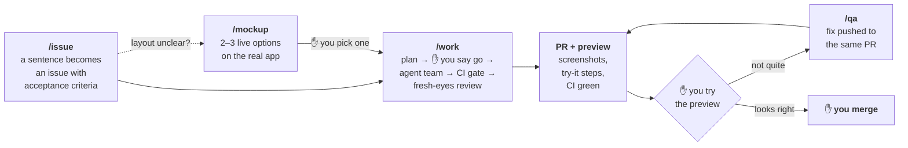

# Claude Code Starter

**Five commands, one human sign-off, and GitHub Actions as the only judge.** An opinionated starter
for shipping real software with Claude Code: you write issues and merge pull requests, and Claude
does everything in between.

It's extracted from the workflow that builds [Kelvin](https://kelvin.lighting), a production app
where most pull requests are planned, built, tested, screenshotted and reviewed by Claude Code
agents, and every one is merged by a person. The commands, skills, hooks and workflows here are that
system with the product-specific parts taken out, around a tiny demo app so everything runs on day one.



`/overnight` runs that loop across every issue labelled `ready` while you sleep, and leaves one
report in the morning.

---

## The idea in 30 seconds

- **You stop exactly twice per issue:** once to say "go" on a short plan, once to try the preview
  and merge. Everything else is decided, done and written down without you.
- **The verdict comes from GitHub Actions, never a laptop.** `pnpm gate` pushes the work-in-progress,
  already merged onto `main`, to a throwaway branch and waits for CI. The PR reuses that run.
- **Every PR arrives finished:** CI green, a fresh-context review, screenshots checked against the
  acceptance criteria, and try-it steps with exact URLs and what you should see.
- **The issue is the command center.** Each issue's thread narrates its own story in plain English,
  so someone who doesn't read code can follow it from "started" to "shipped".
- **Agents never merge.** Branch protection, a deny rule and a hook all say so independently.

## The five commands

| Command | You type | You get back | It stops for you |
|---|---|---|---|
| **`/issue`** | `/issue "thumbnails stretch on wide cards"` | A GitHub issue with testable acceptance criteria | Once, to confirm the draft |
| **`/work`** | `/work 12` | A PR closing #12: CI green, reviewed, screenshots, preview, try-it steps | Once, to approve the plan |
| **`/qa`** | `/qa 41 "crop from the top, not the centre"` | The fix on the same PR, a QA record on the thread, re-test steps | Never (your feedback is the sign-off) |
| **`/mockup`** | `/mockup 15` | A design page with 2–3 clickable options on a live preview | When you pick an option |
| **`/overnight`** | `/overnight` | 3–6 CI-green PRs and one morning report | Once, to approve the shift |

## Quick start

```bash
# 1. "Use this template" on GitHub, then:
gh repo clone <you>/<your-repo> && cd <your-repo>
pnpm install && pnpm check

# 2. Labels and branch protection (shows the plan, asks before changing anything)
bash scripts/setup-github.sh

# 3. Go
claude
```

```
> /issue "the Done tab should list completed tasks newest first"
> /work 1
```

Previews (Vercel), screenshot hosting and the rest: [docs/setup.md](docs/setup.md).

---

## A tour

### `/issue` — a sentence becomes a contract

Claude mines the conversation for who asked, URLs, error text and screenshots, checks for a
duplicate, and shows you a draft. One confirmation and it's filed. The **acceptance criteria are the
contract** for everything that follows, so they're written to be checked on the preview by someone
who didn't build it: *"on a 1440px window, a 4:3 image on a task card renders 4:3"*, never *"looks better"*.

Stories, bugs and epics (one outcome, several sub-issues) each have a template, mirrored in
`.github/ISSUE_TEMPLATE/` for humans.

### `/work` — from issue to finished PR

```
  you               ┊  Claude (orchestrator, Opus)          ┊  sub-agents                  ┊  GitHub
 ───────────────────┊───────────────────────────────────────┊──────────────────────────────┊─────────────────────
  /work 12  ───────▶ read #12, comment "work started"       ┊                              ┊
                    ┊ worktree off fresh origin/main         ┊                              ┊
                    ┊ LOCATE ───────────────────────────────▶ read-only scouts find causes  ┊
  "go"  ◀───────────  ✋ the plan, in plain English          ┊                              ┊
                    ┊ split into file-disjoint units ───────▶ builders (Sonnet), red-first ┊
                    ┊ read the real diff, not the reports    ┊                              ┊
                    ┊ pnpm gate ────────────────────────────────────────────────────────────▶ gate/<lane> → CI
                    ┊ push branch, screenshot the preview ───────────────────────────────────▶ preview
                    ┊ pnpm review ──────────────────────────▶ fresh read-only Claude        ┊
                    ┊ gh pr create ─────────────────────────────────────────────────────────▶ PR (CI reuses gate)
  try it, merge ◀───  "ready to test" on #12, footer        ┊                              ┊
```

The plan you approve is short and readable in a chat window: what was found, what will change, which
behaviour gets tested at which public entry point, and any decision that's yours (a migration, a
fork in approach, anything that costs money). If it's bigger than ~8 files, Claude proposes splitting
it instead of building it.

The PR it opens carries: a summary, a bare `Closes #12`, the plan, a run log (which agent did what,
what review caught), each acceptance criterion met or flagged, the gate run, the review verdict,
a `## Visual evidence` table, and steps like:

```
## Try it on the preview  (~1 min)
1. Open https://app-git-issue-12-acme.vercel.app/tasks at 1440px → the "Q4 plan" card's image is 4:3.
2. Narrow the window to 600px → the card looks as it does on main.
```

`/work <epic#>` does the same for a whole epic: one plan, the proposed sub-issues at the same single
gate, then one PR closing all of them.

### `/qa` — feedback without ceremony

Open the preview, say what's wrong. `/qa` posts a QA-record comment on the PR **before it changes
anything** (your words verbatim, its reading, what it'll change), fixes it on the same branch, gates
it, reviews it, pushes, and replies with re-test steps. Questions get answered on the thread without
code changes. Anything that would grow the PR past its issue gets routed to a new `/issue` instead.

### `/mockup` — decide on a live page, not a picture

For a screen with real layout uncertainty, Claude sketches five or six approaches privately, keeps
two or three that differ in *kind* (not a button moved), and builds them as a design page: a
throwaway route that renders **the real app on sample data**, with tabs for each option and each
state (empty, saving, error, done). Every server action is faked. It screenshots and critiques each
option on the preview before you see it, then posts them with at most two questions.

There's a working example in this repo: `pnpm dev`, then open
[localhost:3000/design/first-run](http://localhost:3000/design/first-run). Three takes on what a new
user sees with zero tasks.

### `/overnight` — wake up to finished PRs

Label issues `ready`, run `/overnight`, approve the shift with one line. Claude groups the issues into
file-disjoint lanes named in plain English, runs one background agent team per lane through
`/work`'s steps without the sign-off, and **decides instead of asking** (every decision logged on a
`shift` issue). An issue that turns out bigger than the night is deferred with a reason rather than
stalling its lane. Before handing you a merge list it merges every lane on a throwaway branch and
gates the result, so the merge order is tested, not hoped. The morning report:

```
## Morning report — 22 Oct
**Shipped, in merge order** — PR #52 Empty states that tell you what to do · CI green · closes #31 #33 #34 · preview …
                             — PR #53 Dates you can trust · CI green · closes #36 #37 · preview …
**Deferred** — #35 needs a decision on recurring tasks: weekly or custom intervals?
**Decisions I took for you** — kept the date format DD MMM to match the task list (#36)
**Needs you** — merge #52 before #53 (both touch TaskList); decide #35
```

---

## GitHub Actions: CI is the gate

```
 lane worktree                    GitHub
 edit, pnpm check (fast)
 pnpm gate ──snapshot + merge onto main──▶ gate/<lane> ──▶ ci.yml ──▶ PASS / FAIL ──▶ back to the lane
 gh pr create ──────────────────────────▶ PR ──▶ ci.yml (same tree already passed → reused)
                                             ├▶ pr-guards.yml   every PR closes an issue · UI PRs carry screenshots · migrations ship alone
                                             └▶ pr-preview-link.yml   pins the preview URL at the top of the PR
                                          on close ▶ gate-cleanup.yml
```

- **One definition of "the full suite":** whatever `ci.yml` runs. Agents and humans run the same
  thing, in the same place.
- **It tests what will merge.** The gate commit is the working tree already merged onto `main`; a
  conflict stops it before anything is pushed.
- **No duplicate runs.** When the PR's tree equals a tree that already passed the gate, CI's first
  job finds that run and skips the rerun (a skipped required check counts as passing).
- **The laptop stays free.** Five lanes don't fight over ports and CPU running five test suites.
- **Rules that matter are checks, not prose.** A PR without a `Closes #n`, a UI change without
  screenshots, a migration mixed with code: each fails a check with a sentence saying how to fix it.

The full topology, branch protection, token scopes and self-hosted runners: [docs/github-actions.md](docs/github-actions.md).

## The rules, and why

| Rule | Why |
|---|---|
| **Agents never merge, never push `main`.** | The person who merges owns the change. Enforced by branch protection, a `gh pr merge` deny rule, and a hook. |
| **Done = CI green on the pushed SHA + review SHIP.** | "Passes locally" is a claim about a different tree. A red PR makes you do the triage the agent should have done. |
| **One sign-off, before the code.** | Approving a plan takes a minute; reviewing the wrong 400-line diff takes an hour. |
| **Verify, don't trust.** | Sub-agent reports, green ticks, greps and the agent's own reasoning are claims. The diff, the CI run and a test seen to fail are evidence. |
| **Fresh eyes review every PR.** | The session that wrote the code is the worst-placed reviewer of it. A separate read-only Claude reads the diff and tries to refute every finding before reporting it. |
| **Tests go red before they go green.** | A test nobody saw fail might not be able to. Changed tests need a deliberate-break receipt in the PR. |
| **A visual change ships with screenshots, read against the criteria.** | "Tests pass" says nothing about how it looks; a screenshot of a login wall proves nothing either. |
| **Worktrees, explicit staging.** | Several lanes share one machine. `git add -A` picks up another lane's files, a secret, or scratch. |
| **The agent's token has no `workflow` scope.** | A workflow can read every secret. CI changes are proposed in the PR body and applied by a human. |
| **The issue thread is written for a non-coder.** | Whoever asked for the change can follow it without opening the PR. |

## How it's built

**Thin front doors, shared engines.** Each command is a short procedure that calls skills; each
rule lives in exactly one file. Change how review works in `local-review/SKILL.md` and `/work`,
`/qa` and `/overnight` all pick it up.

```
CLAUDE.md                        the constitution: facts, the flow, the rules
.claude/
  commands/                      what you type
    issue.md  work.md  qa.md  mockup.md  overnight.md
  skills/                        the engines, loaded by Claude (hidden from the / menu)
    agent-team/      file-disjoint units, parallel builders, verify-don't-trust, run log
    gate/            pnpm gate, waiting in the background, what counts as green
    local-review/    the fresh-context read-only reviewer (+ prompt.md)
    tdd/             seams, red-first, what may be faked, the deliberate-break receipt
    visual-evidence/ capture on the preview, read every image, upload, aggregate
    check-steps/     URL → action → what you should see; the two-phase preview link
    design-pages/    /mockup's build-to-decision flow
    handback/        the three-line footer on every message
  hooks/
    guard-bash.mjs           PreToolUse: blocks merge, push to main, force-push, git add -A, reset --hard
    check-root-checkout.sh   SessionStart: warns when the root checkout isn't a clean main
  scripts/
    local-review.sh          claude -p --model opus --tools "Read,Grep,Glob"
    upload-evidence.mjs      immutable screenshot hosting for issues and PRs
  settings.json              hooks + allow/deny rules
.github/
  workflows/                 ci.yml · pr-guards.yml · pr-preview-link.yml · gate-cleanup.yml
  ISSUE_TEMPLATE/            story · bug · epic
  pull_request_template.md
scripts/
  gate.mjs                   pnpm gate
  capture.mjs                pnpm capture: headless screenshots, fails on a login wall
  design-capture.mjs         pnpm design:capture: every option of a design page
  setup-github.sh            labels + branch protection, after showing the plan
app/ components/ lib/        the demo app ("Tasks"), and the design host under app/(design)
tests/unit/                  including tests for the gate and the guard hook
docs/                        workflow · github-actions · setup · adapting
```

**Every message ends with a footer** once something exists, so you can flip between five sessions
and re-sync from the last message alone:

```
---
🔗 **PR [#41](…)** · preview https://app-git-issue-12-acme.vercel.app · issue [#12](…)
**Session:** `/work #12` — thumbnails keep their aspect ratio on wide cards. Gate green, review SHIP.
**Just did:** opened the PR, posted "ready to test" on #12. **Next:** you try the preview and merge.
```

## Make it yours

- **New project:** use the template, replace the demo app, fill in the facts block in `CLAUDE.md`.
- **Existing repo:** copy `CLAUDE.md`, `.claude/`, `.github/`, `scripts/gate.mjs`, `scripts/capture.mjs`,
  `scripts/lib/`, `scripts/setup-github.sh`, and the `gate`, `review`, `check`, `capture` and `evidence`
  entries from `package.json`. Then point `ci.yml` at your own build and test commands.
- **Another stack:** the process doesn't care. [docs/adapting.md](docs/adapting.md) lists every touch point.

## FAQ

**Which plan do I need?** Any Claude plan with Claude Code. Orchestration, design and review run on
Opus; file-editing builders run on Sonnet. `/overnight` is the heavy one: it can use a lot of your
usage window, and resumes when the window resets.

**Does it work without Vercel?** Yes. Previews are what you review, screenshot and click through,
so you want *some* per-branch preview; any host works ([docs/github-actions.md#previews](docs/github-actions.md#previews)).
Without one, `/work` still ships a CI-green, reviewed PR; the screenshots come from a local build.

**Why not let the agent merge when CI is green?** Because CI green means the tests you wrote pass,
not that the change is right. The thirty seconds you spend on the preview is the cheapest review
there is, and it keeps a person accountable for what reaches users.

**Why GitHub Actions and not local tests?** One suite, one place, one verdict, on exactly the
tree that will merge. Locally, five parallel lanes fight over ports, and "it passed on my machine"
can't be checked by anyone else.

**Can I run several sessions at once?** That's the point. Each lane works in its own worktree and
gates on its own `gate/<lane>` branch; the footer tells you where each one stands.

## Docs

| | |
|---|---|
| [docs/workflow.md](docs/workflow.md) | One issue followed from a sentence to production, plus epics and the night shift |
| [docs/github-actions.md](docs/github-actions.md) | The CI topology, `pnpm gate` step by step, branch protection, tokens and secrets, self-hosted runners |
| [docs/setup.md](docs/setup.md) | Prerequisites, GitHub, Vercel, screenshot hosting, first run |
| [docs/adapting.md](docs/adapting.md) | Porting to another stack, and what to add as you grow |
| [CLAUDE.md](CLAUDE.md) | The rules every session reads first |

## Credits

The test-driven loop in `.claude/skills/tdd/` is adapted from Matt Pocock's
[engineering/tdd skill](https://github.com/mattpocock/skills/tree/main/skills/engineering/tdd).
Everything else came out of building Kelvin.

MIT licensed. See [LICENSE](LICENSE).
