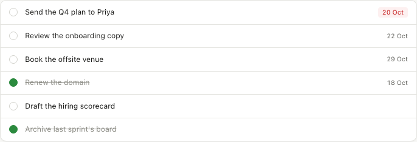
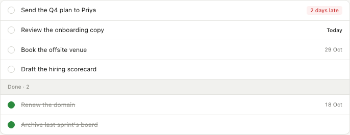

# Example: the PR the workflow produces

This is a real run on this repo's demo app: an epic with two issues, built by `/work` and
reviewed by the adversarial reviewer. Every PR has these sections in this order.

The screenshots came from local builds of `main` and the branch, because the repo had no remote
when it ran; normally **Before** is `main`'s deployment and **After** is the branch's preview. The
gate ran the same steps `ci.yml` runs, locally, for the same reason.

---

> **The task list reads at a glance (#1)** · `epic/1-task-list-at-a-glance` → `main` · 4 commits · 7 files, +194 −16

**Preview:** pinned here by `pr-preview-link.yml` once Vercel builds the branch

## Summary

Overdue tasks now say how late they are, a task due today says "Today", and finished tasks sink
below a "Done · 2" divider, so open work is what you see first. The summary counts don't change.

Closes #2
Closes #3

## Visual evidence

| Issue | What changed | Before | After |
|---|---|---|---|
| #2 | An overdue task says how late it is; one due today says "Today" |  |  |
| #3 | Done tasks drop below a "Done · 2" divider; open tasks are sorted by due date |  |  |

## Try it on the preview  (~1 min)

1. Open `<preview>/` → "Send the Q4 plan to Priya" shows **2 days late** in red; "Review the
   onboarding copy" shows **Today**.
2. Same page → the open tasks end with "Draft the hiring scorecard" (no date), then a
   **Done · 2** row, then the two struck-through tasks.
3. Control: open `main`'s deployment → the same task shows **20 Oct**, and "Renew the domain" sits
   fourth, among the open tasks.

## Acceptance criteria

**#2 Overdue tasks say how late they are**
- [x] An open task due before today shows "1 day late" / "N days late": `dueLabel` tests for 1 day,
  2 days and across a month boundary, and the rendered list test.
- [x] An open task due today shows "Today": `dueLabel` test and the rendered list test.
- [x] Future dates are unchanged ("29 Oct"); a done task keeps its date: `dueLabel` tests.

**#3 Done tasks sink to the bottom**
- [x] Open tasks first, by due date, undated after dated, ties in list order: `listOrder` tests.
- [x] Done tasks under a quiet "Done · 2" divider: the rendered list test.
- [x] The summary counts are unchanged: the existing `summarize` tests, untouched, and the e2e
  smoke (4 open · 1 overdue · 2 done).

## Plan

- **#2** — `dueLabel(task, today)` in `lib/format.ts` returns the chip's text and tone (`late`,
  `today`, `date`), counting calendar days in UTC so the viewer's timezone can't shift it.
  Tested at `dueLabel` and at the rendered `TaskList`.
- **#3** — `listOrder(tasks)` in `lib/tasks.ts` splits open from done and sorts open tasks by due
  date, stable, undated last. `TaskList` renders open tasks, the divider, then done tasks.
  Tested at `listOrder` and at the rendered `TaskList`.
- Files: `lib/format.ts`, `lib/tasks.ts`, `components/TaskList.tsx`, `app/globals.css`, three test files.

## What happened

**Base:** main @ `60a75d7` · **Units:** 2, file-disjoint (#2 in `lib/format.ts`; #3 plus the
rendering of both in `TaskList.tsx`) · **Loop passes:** 3

| Unit | Change | Files | Red first |
|---|---|---|---|
| #2 | the chip says how late | `lib/format.ts`, `tests/unit/due-label.test.ts` | 4 red: "expected '20 Oct' to equal '2 days late'" … |
| #3 | done tasks sink; the list renders both | `lib/tasks.ts`, `components/TaskList.tsx`, `app/globals.css`, `tests/unit/tasks.test.ts`, `tests/unit/task-list.test.tsx` | 3 red: "expected ['venue', 'archive', …] to equal […]" … |

| Pass | Verify | Gate | Review | Then |
|---|---|---|---|---|
| 1 | ✓ the diff matches the plan | ✓ 109 tests | **FINDINGS**: 1 LOW, 2 test gaps | caused by this change → fresh fixer (Sonnet), briefed with just those |
| 2 | ✓ the fixer touched only its 3 files; both new tests seen red first | ✓ 111 tests | **FINDINGS**: 1 LOW, a comment restating its helper | a one-line delete: the orchestrator does it itself |
| 3 | ✓ | ✓ 111 tests | **SHIP**, 10 attacks tried, all held | open the PR |

**Caught on the way:** the fixer's first draft of a test comment carried a date; the custom
`no-narrating-comments` rule failed lint and it was fixed before hand-back.

## Test gate

The steps `ci.yml` runs, run locally on the rebased branch:

| Layer | Result |
|---|---|
| ESLint + custom rules | ✓ 0 problems |
| TypeScript, strict | ✓ |
| Unit + convention tests | ✓ 111 passed, 12 files |
| Build | ✓ |
| E2E smoke (Playwright) | ✓ 3 passed |

## Local review

**Verdict: SHIP** (pass 3). `pnpm review`: a fresh `claude -p --model opus` session with read-only tools.

**Attacks tried** (pass 3)
- `dueLabel` day count: 1 day (singular), 2 days, across a month end, a year end, a leap day and the US DST change → held
- "Today": open due today, done due today, done and late, future, no date → held
- A malformed `due` (`""`) would read ~46,000 days late; nothing in the app can produce one (sample data, the design page and the add action never set `due`) → held
- `listOrder`: undefined on either or both sides, same-day ties, a readonly input; it sorts a copy, stably → held
- A done task due before every open task still sinks below the divider → held
- Other callers of `TaskList`: the home page and the first-run design page; the e2e `^Done$` locator is scoped to `.summary` → held
- React keys around the divider; the `data-overdue` → `data-tone` rename (no stragglers); divider borders in every position; summary counts vs chips → held

**Findings, every pass**
| Pass | Finding | Disposition |
|---|---|---|
| 1 | [LOW] `app/globals.css:377` — when every task is done, the divider's top border doubles the panel's | fixed in `e5e06dc`: `.task-divider:first-child { border-top: 0 }` |
| 1 | Test quality — no test for a done task due today; no test sees the chip's `data-tone` | fixed in `e5e06dc`: two tests, each seen red on an assertion |
| 2 | [LOW] `tests/unit/task-list.test.tsx:17` — a comment restating the `rows()` helper | fixed in `7ca7d81`: deleted |
| 3 | Test quality, no defect — the "no divider" test can't see a stray `0` outside the list items | deferred: Follow-ups considered |

## Follow-ups considered

- The **Today** and **Done** tabs in the nav both link to the inbox; giving them their own views
  is its own issue.
- A task due tomorrow could say "Tomorrow"; left out to keep #2 to what was asked.
- The "no divider when nothing is done" test can't see a stray `0` rendered outside the list
  items (review pass 3); worth a stronger assertion the next time the list changes.
